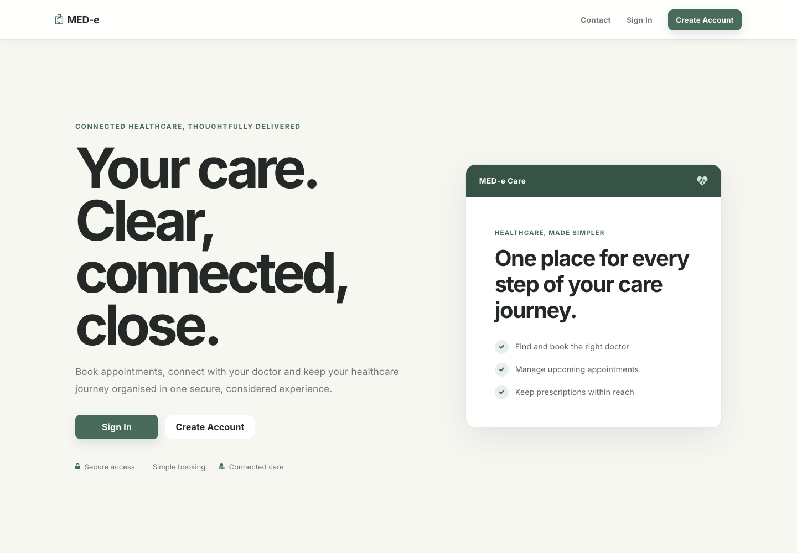
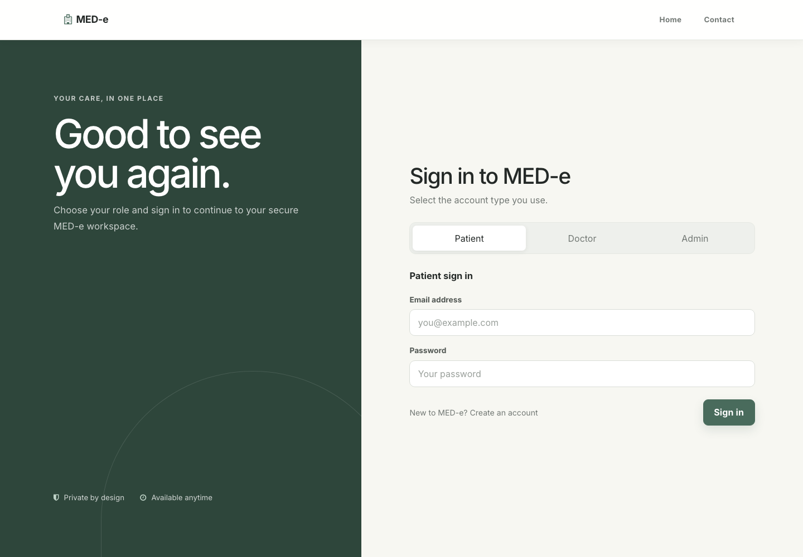
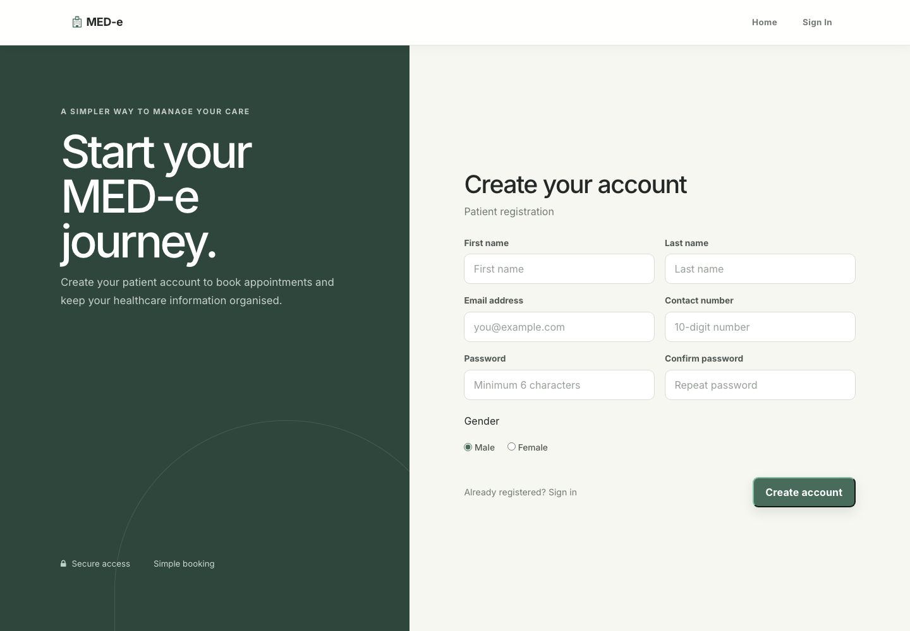

# MED-e Web Booking System

MED-e is a role-based healthcare appointment platform built with PHP and MySQL. It gives patients, doctors, and administrators focused workspaces for managing appointments and prescriptions through a responsive, premium healthcare interface.

> **Portfolio notice:** MED-e is an educational localhost project. It has not been security-hardened for production use and must not be used with real patient or clinical data.

## Features

### Patients

- Create an account and sign in securely through a session-based flow
- Browse doctors and book an available appointment
- Review appointment history and cancellation status
- View prescriptions issued by doctors
- Send messages through the contact page

### Doctors

- Sign in to a dedicated doctor workspace
- Review patient appointments
- Cancel appointments when required
- Create and review prescriptions

### Administrators

- View registered doctors and patients
- Review appointments, prescriptions, and contact messages
- Add or remove doctor accounts

## Technology

- PHP 8 with PHP sessions and MySQLi
- MySQL / MariaDB (`hospitalms` database)
- HTML5, CSS3, JavaScript, and jQuery
- Bootstrap, Font Awesome, and local frontend assets
- XAMPP for local Apache and MySQL development

## Screenshots

### Homepage



### Role-based sign in



### Patient registration



## Local installation with XAMPP

1. Install [XAMPP](https://www.apachefriends.org/) and start **Apache** and **MySQL**.
2. Clone this repository into the XAMPP web root:

   ```bash
   cd /Applications/XAMPP/xamppfiles/htdocs
   git clone <repository-url> "Booking System"
   ```

   On Windows, use `C:\xampp\htdocs` instead.

3. Open phpMyAdmin at `http://localhost/phpmyadmin`.
4. Import [`database/schema.example.sql`](database/schema.example.sql). It creates the `hospitalms` database and tables without private data.
5. Create your own administrator record for local testing:

   ```sql
   INSERT INTO admintb (username, password)
   VALUES ('your-admin-name', 'your-local-password');
   ```

6. Open `http://localhost/Booking%20System/`.
7. Register a patient account from the website. After signing in as the administrator, create doctor accounts from the admin dashboard.

The current code expects XAMPP's default local MySQL connection: host `localhost`, user `root`, blank password, and database `hospitalms`. If your local MySQL setup differs, update the connection values locally and do not commit private credentials.

## Main routes

| Route | Purpose |
| --- | --- |
| `index.php` | Public homepage |
| `index1.php` | Patient, doctor, and admin sign in |
| `register.php` | Patient account registration |
| `admin-panel.php` | Patient dashboard |
| `doctor-panel.php` | Doctor dashboard |
| `admin-panel1.php` | Administrator dashboard |
| `contact.php` | Contact form |

## Privacy and security

- Real database exports, login-detail notes, environment files, and local configuration files are excluded by `.gitignore`.
- The included schema contains no account credentials or patient information.
- The legacy application stores passwords as plaintext and uses direct SQL queries. Before any production use, add password hashing, prepared statements, CSRF protection, stronger authorization checks, and secure secret management.
- Use only fictional test data while developing this project.

## License

This project is provided as a private portfolio and educational project. No separate open-source license is granted.
